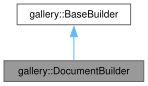
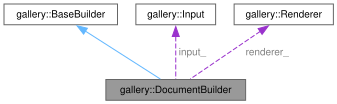
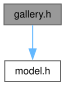
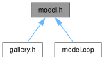
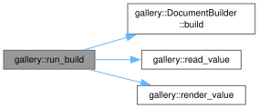
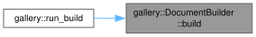
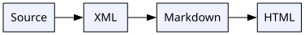
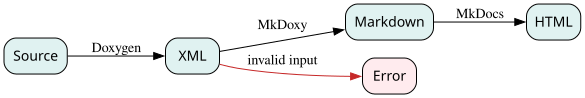
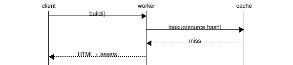
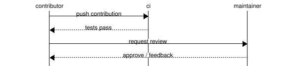

# Image and diagram gallery

This page is part of the main MkDoxy documentation. The images in the first
section pass through Doxygen and MkDoxy during this site's build. The native
diagrams in the second section are stored reference outputs generated by
Doxygen and Graphviz.

See [Images and diagrams](../usage/images-and-diagrams.md) for installation,
configuration and current support limitations.

## Images included by MkDoxy

These seven real image files are referenced by `@image html` in the `ImageExample`
class. Open the [generated API page](../imageExamples/classImageExample.md) to
see them inside the actual API documentation. JPG and JPEG share one encoding.

| Input | Rendered image | Origin |
| --- | --- | --- |
| SVG |  | Authored vector source |
| PNG |  | Drawing commands in the raster generator |
| JPG |  | Raster generator; lossy encoding |
| JPEG |  | Raster generator; alternative JPEG extension |
| GIF |  | Four-frame animation from the raster generator |
| BMP |  | Raster generator; uncompressed encoding |
| WebP |  | Raster generator; lossless encoding |

These are illustrative drawings, not measurements of project performance.
Only regenerating raster inputs requires Pillow; ordinary documentation builds
consume the stored files. No Graphviz installation is required for this section.

??? example "Actual Doxygen image comments"

    ```cpp
    --8<-- "tests/integration/fixtures/image_assets/src/image_example.h"
    ```

??? example "Raster image generator"

    ```python
    --8<-- "tests/integration/fixtures/image_assets/generate_assets.py"
    ```

## Diagrams generated by native Doxygen

The following are native Doxygen outputs embedded as static illustrations.
**Automatic rendering of these graph elements by MkDoxy is not implemented.**
The SVG and PNG variants were generated from the same C++ or text input.
Normal site builds use the stored illustrations and do not run Graphviz.

| Diagram | SVG example | Raster variant |
| --- | --- | --- |
| Inheritance |  | [PNG](../media/diagrams/inheritance.png) |
| Collaboration |  | [PNG](../media/diagrams/collaboration.png) |
| Includes |  | [PNG](../media/diagrams/includes.png) |
| Included by |  | [PNG](../media/diagrams/included-by.png) |
| Calls |  | [PNG](../media/diagrams/calls.png) |
| Callers |  | [PNG](../media/diagrams/callers.png) |
| Inline `dot` |  | [PNG](../media/diagrams/dot.png) |
| External `dotfile` |  | [PNG](../media/diagrams/dotfile.png) |
| Inline `msc` |  | [PNG](../media/diagrams/sequence.png) |
| External `mscfile` |  | [PNG](../media/diagrams/mscfile.png) |

??? example "C++ declarations: inheritance and collaboration"

    ```cpp
    --8<-- "demo-projects/diagrams/model.h"
    ```

??? example "C++ implementations: calls and callers"

    ```cpp
    --8<-- "demo-projects/diagrams/model.cpp"
    ```

??? example "Inline Doxygen graph commands"

    ```cpp
    --8<-- "demo-projects/diagrams/gallery.h"
    ```

??? example "External Graphviz definition"

    ```dot
    --8<-- "demo-projects/diagrams/states.dot"
    ```

??? example "External sequence chart definition"

    ```text
    --8<-- "demo-projects/diagrams/exchange.msc"
    ```

??? example "Native Doxygen configuration"

    ```text
    --8<-- "demo-projects/diagrams/Doxyfile"
    ```

## Reproduce the examples

The [setup and regeneration instructions](../usage/images-and-diagrams.md#build-and-inspect-the-complete-gallery)
explain how to build the standalone gallery and refresh the static diagrams.
Regenerating them requires Graphviz; their output can vary with tool and font
versions. PlantUML and Dia examples are not generated here.
