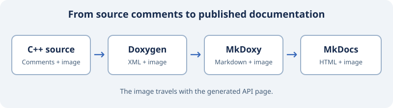
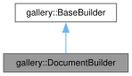
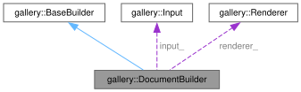
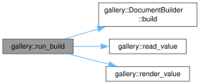
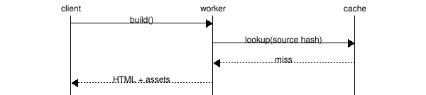

# Images and diagrams

MkDoxy can include existing images referenced by Doxygen comments in generated
API pages. Doxygen can also draw graphs from code or text definitions. These
are two separate workflows with different tool requirements.

Open the [image and diagram gallery](../examples/images-and-diagrams.md) on this
site to see all seven image inputs and ten native Doxygen diagram examples.
The [generated ImageExample API](../imageExamples/classImageExample.md) shows
images copied by MkDoxy during this documentation build.

## Support and required tools

| Task | Tools to install | Where it works |
| --- | --- | --- |
| Copy existing SVG, PNG, JPG/JPEG, GIF, BMP or WebP images referenced by `@image html` | Python with MkDoxy/MkDocs, plus the Doxygen executable | MkDoxy full API documentation |
| Generate inheritance, collaboration, include, call or caller graphs | Doxygen and Graphviz (`dot`) | Native Doxygen output; automatic MkDoxy rendering is not implemented |
| Render `@dot` or `@dotfile` definitions | Doxygen and Graphviz (`dot`) | Native Doxygen output |
| Render `@msc` or `@mscfile` sequence charts | Doxygen with built-in mscgen, as in the tested Doxygen 1.15.0 | Native Doxygen output |
| Build the combined repository gallery | The locked development environment, Doxygen and Graphviz | Local Material for MkDocs gallery |
| Regenerate the repository's raster input fixtures | Pillow 12.1.1 | Optional maintainer task; not needed to build or test the existing inputs |

Graphviz and Pillow are not required to copy an existing image through MkDoxy.
Python packages do not install the system Doxygen or Graphviz executables.

On Debian/Ubuntu, install Doxygen; add Graphviz when generating diagrams:

```sh
sudo apt update
sudo apt install doxygen
sudo apt install graphviz  # Optional for existing images; needed for graph examples.
```

For other systems, use the [Doxygen downloads](https://www.doxygen.nl/download.html)
and [Graphviz installation instructions](https://graphviz.org/download/).
Make their executables available on PATH, then verify:

```sh
doxygen --version
dot -V  # Only needed for Graphviz-based diagrams.
```

The plugin's Python requirement is declared in `pyproject.toml` (currently
Python 3.10 or newer). Install MkDoxy in your Python environment; a source
checkout can use the setup in the
[contributing guide](https://github.com/JakubAndrysek/MkDoxy/blob/main/CONTRIBUTING.md).
The examples on this page describe the image-copy support in the source tree;
an older installed package release may not include it yet.

## Include an existing image

For this layout:

```text
my-project/
├── mkdocs.yml
├── docs/
│   └── index.md
├── src/
│   └── image_example.h
└── images/
    └── pipeline.svg
```

Reference the image in `src/image_example.h`:

```cpp
/**
 * Build documentation from source code.
 *
 * @image html pipeline.svg
 */
class ImageExample {
public:
    /** Generate the API documentation. */
    void build();
};
```

Configure Doxygen's image search path in `mkdocs.yml`:

```yaml
site_name: My documentation
plugins:
  - mkdoxy:
      projects:
        api:
          src-dirs: src
          full-doc: true
          doxy-cfg:
            FILE_PATTERNS: '*.h *.cpp'
            IMAGE_PATH: images
            EXAMPLE_PATH: ''
            EXTRACT_ALL: true
            GENERATE_HTML: false
            GENERATE_LATEX: false
      full-doc: true
markdown_extensions:
  - tables
```

Run `mkdocs build` from `my-project/`. Paths such as `src` and `images` in this
example are relative to that working directory.

Doxygen copies the image into its XML output. MkDoxy copies it alongside the
generated API Markdown and registers it with MkDocs. MkDocs then produces the
HTML page and the image asset in the site directory. No separate copy step is
needed for this full-documentation workflow.

The resulting API page displays this diagram:



The supported extensions are `.svg`, `.png`, `.jpg`, `.jpeg`, `.gif`, `.bmp`
and `.webp`, matched without regard to extension case. JPG and JPEG share one
encoding. Animated GIF files retain their input bytes. Rendering still depends
on the browser's support for the chosen format.

The current image renderer emits a Markdown image with the alt text `Image`.
Doxygen caption and size options are not currently forwarded to that Markdown.
Automatic asset copying requires full documentation to be enabled at both the
plugin and project level; a snippet-only project does not run this copy step.

### Custom output paths and rebuilding

A project can set `api-path: reference/cpp` and the plugin can set
`save-api: build/doxygen` to retain its generated files. Image assets follow
the selected API path. Both directory URLs and `use_directory_urls: false`
are covered by the image integration tests.

When retaining Doxygen output with `save-api`, `mkdocs build --clean` cleans the
site directory but does not remove that separate saved cache. An image-only
edit outside `src-dirs` may not invalidate the source cache. Rebuild using a
fresh saved-output directory when updating such images.

Different assets cannot share one output path: MkDoxy stops the build if a
generated image conflicts with an existing documentation asset. An identical
file already present in `docs/` is reused. Remove an obsolete manually copied
asset or rename it to resolve a conflict. Copy failures also stop the build;
they are not silently omitted. Symlinks that resolve outside the XML source
directory or API destination are rejected.

If an image is missing, check the filename and its case, `IMAGE_PATH`, the
Doxygen diagnostics, the generated XML image reference, and the final HTML
image URL. A successful build alone does not prove that an image URL works.

## Generate diagrams with native Doxygen

Doxygen and Graphviz can derive diagrams from C++ structure. For example,
`demo-projects/diagrams/model.h` declares a builder with a base class and two
member types. The following illustrations are generated from that example.

**These are native Doxygen outputs embedded as documentation illustrations.**
MkDoxy does not currently turn these graph elements in Doxygen XML into
Markdown diagrams. Setting `HAVE_DOT` alone does not add them to a MkDoxy page.
You can publish native Doxygen HTML separately or generate a static image and
include it through the existing-image workflow above.

| Diagram | Input Doxygen uses | Example output |
| --- | --- | --- |
| Inheritance | C++ base classes |  |
| Collaboration | C++ member types and inheritance |  |
| Calls | Function calls in C++ implementations |  |

The example `Doxyfile` enables graph generation:

```text
GENERATE_HTML = YES
GENERATE_XML = YES
HAVE_DOT = YES
DOT_IMAGE_FORMAT = svg
CLASS_GRAPH = YES
COLLABORATION_GRAPH = YES
CALL_GRAPH = YES
CALLER_GRAPH = YES
INCLUDE_GRAPH = YES
INCLUDED_BY_GRAPH = YES
SOURCE_BROWSER = YES
```

The [Doxygen graph manual](https://www.doxygen.nl/manual/diagrams.html) describes
these graph types and their configuration. The repository gallery generates
both SVG and PNG versions.

### Explicit graph definitions

An inline Graphviz graph can be placed inside a Doxygen comment:

```cpp
/**
 * @dot
 * digraph Build {
 *   rankdir=LR;
 *   Source -> XML -> Markdown -> HTML;
 * }
 * @enddot
 */
```

Alternatively, `@dotfile states.dot` reads a separate Graphviz definition.
`DOTFILE_DIRS` tells Doxygen where to find that input.

Sequence charts can use Doxygen's built-in mscgen:

```cpp
/**
 * @msc
 * client,worker,cache;
 * client=>worker [label="build()"];
 * worker=>cache [label="lookup(source hash)"];
 * cache>>worker [label="miss"];
 * worker>>client [label="HTML + assets"];
 * @endmsc
 */
```



`@mscfile exchange.msc` reads a separate sequence definition, configured through
`MSCFILE_DIRS`. These commands are demonstrated in
[`demo-projects/diagrams/`](https://github.com/JakubAndrysek/MkDoxy/tree/main/demo-projects/diagrams).

### Additional optional tools

Doxygen also supports PlantUML diagrams through a Java runtime and a PlantUML
JAR, and Dia diagrams through the Dia executable. These tools are separate
installations and were not used to generate the repository gallery. Some
PlantUML diagram types also need Graphviz. Mermaid commands and rendering modes
depend on the installed Doxygen version. Consult the matching
[Doxygen command reference](https://www.doxygen.nl/manual/commands.html) before
using these optional integrations.

## Build and inspect the complete gallery

From a repository checkout, install Doxygen and Graphviz, then run:

```sh
uv sync --locked --extra dev
uv run --locked --extra dev python demo-projects/diagrams/build_gallery.py
```

The command prints the path to a newly generated `site` directory. It contains
seven image inputs displayed through MkDoxy, ten native Doxygen graph examples,
SVG and PNG graph variants, and expandable views of the actual source files.
To inspect it in a browser, serve the printed directory, replacing the path:

```sh
python -m http.server 8000 --directory /path/printed/by/the/command/site
```

Normal gallery builds need no Pillow: the raster inputs are stored in the
repository. Only regenerating those inputs requires it:

```sh
uv run --locked --extra dev --with pillow==12.1.1 python tests/integration/fixtures/image_assets/generate_assets.py
```

This changes fixture files. Review the resulting images and rerun the tests;
do not automatically accept a regenerated output as correct. The seven-format
fixture is in
[`tests/integration/fixtures/image_assets/`](https://github.com/JakubAndrysek/MkDoxy/tree/main/tests/integration/fixtures/image_assets).

To refresh the static native-diagram illustrations used on this site explicitly:

```sh
uv run --locked --extra dev python demo-projects/diagrams/build_gallery.py --export-docs-assets
```

This updates `docs/media/diagrams/`. Review the SVG differences: layout can vary
with Doxygen, Graphviz and font versions. Ordinary documentation builds consume
these stored illustrations and do not require Graphviz. The gallery examples
were generated with Doxygen 1.15.0 and Graphviz 14.1.2.
